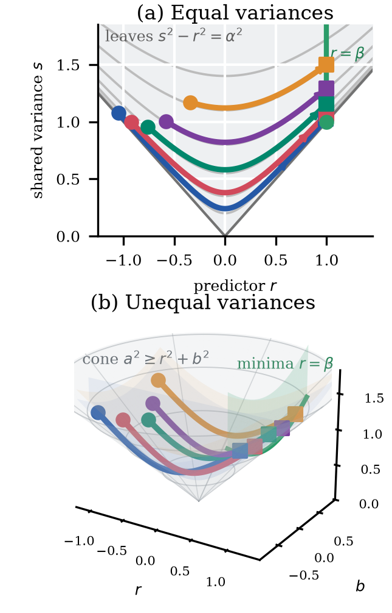

# Gaussian W2 cone geometry

This draft accompanies `code/notebooks/research/gaussian_w2_cone_geometry.ipynb` and the generated figure
`code/figures/gaussian_w2_cone_geometry.pdf`.



We consider the centered Gaussian law of a scalar two-layer linear neuron `(u,v)`, with
second moment

```math
\Sigma = \begin{pmatrix} p & r \\ r & q \end{pmatrix}.
```

The predictor is the cross moment `r=E[uv]`. For the whitened square loss
`F(Sigma)=1/2 (r-beta)^2`, the Gaussian W2 gradient flow is the Bures flow

```math
\dot p = \dot q = -2r(r-\beta), \qquad
\dot r = -(p+q)(r-\beta).
```

The two scalar invariants are `p-q` and `pq-r^2`. In Lorentz coordinates

```math
a=\frac{p+q}{2}, \qquad b=\frac{p-q}{2},
```

the covariance cone is

```math
a^2 \ge r^2+b^2, \qquad a\ge 0.
```

The equal-variance assumption `p=q` means `b=0`. This is the central two-dimensional
slice of the cone, where the conserved leaves are the hyperbolas

```math
s^2-r^2=\alpha^2, \qquad s=p=q.
```

The global minimizers form the line `r=beta` inside this slice, and each leaf selects
one endpoint `s_infty=sqrt(beta^2+alpha^2)`.

Without the equal-variance assumption, the same picture lives in the full three-dimensional
Lorentz cone. The flow conserves

```math
b=\frac{p-q}{2}, \qquad \alpha^2=a^2-r^2-b^2=pq-r^2,
```

so a trajectory is the intersection of the invariant plane `b=b0` and the invariant
hyperboloid `a^2-r^2-b^2=alpha^2`. The global minimizers are no longer a line in the
full cone; they form the sheet `r=beta`, and each conserved leaf selects the point

```math
r_infty=\beta, \qquad a_infty=\sqrt{\beta^2+b_0^2+\alpha^2}.
```

This is the scalar Gaussian counterpart of the paper's covariance-level conservation law:
the spectrum of `J Sigma` is conserved, while the hyperbolically isotropic equal-variance
leaf upgrades that spectral law into the explicit formula for the hidden covariance.
